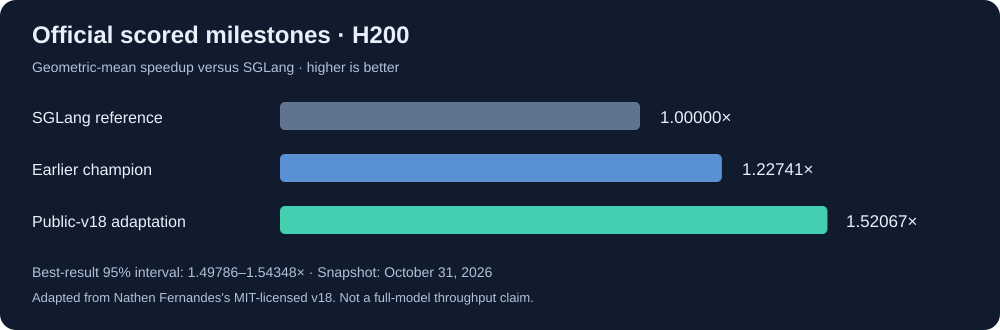

# H200 Kernel Lab

**A reproducible GPU performance-engineering case study for the Open Kernel Challenge.**

Optimizing exact BF16 projection kernels on NVIDIA H200: lossless compression, CUDA tensor-core pipelines, cuBLASLt, profiling, and controlled benchmarking.

**Official scored result: 1.52067× versus SGLang · 9/9 correctness tests passed · no reported integrity flags.**

That corresponds to approximately **34.24% lower benchmark execution time** than the challenge baseline. This is the challenge's geometric-mean metric, not a claim about full-model serving throughput. Snapshot: October 31, 2026.



## Start here

| Reader | Suggested path |
|---|---|
| Recruiter or hiring manager | [Engineering case study](docs/CASE_STUDY.md) — problem, decisions, contribution, lessons |
| GPU/kernel engineer | [Architecture](docs/ARCHITECTURE.md) → [benchmark methodology](docs/BENCHMARKING.md) → [experiment ledger](docs/EXPERIMENTS.md) |
| Reviewer checking the claims | [Results and evidence](docs/RESULTS.md) → exact champion source and official result |
| Someone reproducing the work | [Reproduction guide](docs/REPRODUCING.md) → CPU-only artifact verification |

## What this project demonstrates

- Auditing and integrating public CUDA implementations with explicit provenance and licensing.
- Designing paired CUDA-graph benchmarks with cold-L2 flushing, independent weight seeds, fresh inputs, and identical-code controls.
- Investigating lossless BF16 representations, exception handling, warp specialization, WGMMA, TMA, and cuBLASLt schedules.
- Diagnosing misleading comparisons caused by different dispatch paths and CUDA library stacks.
- Preserving exact-byte champions and declining to promote results that do not survive confirmation.
- Running bounded H200 development experiments using promotional credits with a verified $0 spending cap.

## Contribution and attribution

This is an **AI-assisted research and integration project**, developed with coding agents and external research assistance. The artifacts support review of the engineering process; they are not presented as evidence that all CUDA was written independently by hand.

The officially scored best is an adaptation of **[Nathen Fernandes's public v18 solution](https://github.com/NathenFernandes/muse-bf16-proj/tree/solution)**, under MIT. Its main adaptation replaces a serving-library dispatch dependency with an explicit linear fallback and preserves attribution. The 1.52067× result must not be described as a novel kernel invented here. The project's added work includes audit, independent validation, benchmark calibration, experiment tooling, candidate integration and documented rejection of unsuccessful changes.

Later experimental candidates incorporate **[vjeux's SK2 kernels](https://github.com/vjeux/okc-2026)** under Apache-2.0. They are separately identified and have not replaced the scored champion. See [provenance and licensing](docs/PROVENANCE.md).

## Verified status

| Artifact | Evidence | Status |
|---|---|---|
| Earlier project champion | Official scored **1.22741×** | Preserved |
| Public-v18 adaptation | Official scored **1.52067×**, 95% interval **[1.49786, 1.54348]** | Current scored best |
| SK2 hybrid | Official free check **1.53485×**, interval **[1.51183, 1.55788]** | Not promoted; overlapping uncertainty and modest local margin |
| Narrow batch-32 SK2 | Two-seed local aggregate ratios **1.00856× / 1.00415×** versus parent | Development only; not an official score |

Rank was **270 of 1,515 at the champion submission**, not top 10. This is a historical snapshot, not a live rank or final challenge placement. A 40% reduction relative to the prior best was an aspiration, not an achieved result.

## Repository map

```text
assets/                       Overview chart
scripts/verify_artifacts.py    CPU-only integrity and syntax checks
scripts/summarize_results.py   Recalculate headline scores from saved evidence
docs/                         Curated case study, results, methods, provenance
licenses/                     Third-party license texts
muse_bf16_proj/
  champions/                  Immutable earlier and current scored snapshots
  candidates/                 Experimental and adapted submissions
  modal_lab/                  Bounded H200 runners and benchmark evaluators
  kernels/                    Early kernel experiments
  native_pipeline/            Native CUDA overlap experiments
  cutlass_lab/, cutlass_decode/ CUTLASS experiments and dependency pins
  cuBLASLt/                   Algorithm-planning experiments
  planning/                   Historical experiment reports
  research/                   Source provenance and audits
  results/                    Selected machine-readable experiment evidence
  tools/, tests/              Supporting local tooling
```

**Important:** `muse_bf16_proj/submission.py` is the preserved **older** version. The current champion is [`champions/2026-10-31_1.520670/submission.py`](muse_bf16_proj/champions/2026-10-31_1.520670/submission.py).

## Inspect without a GPU

```bash
python3 scripts/verify_artifacts.py
python3 scripts/summarize_results.py
```

These commands do not import or execute CUDA candidates, contact cloud services, or submit challenge entries. GPU reproduction requires an H200-compatible CUDA environment and your own credentials; see [the guide](docs/REPRODUCING.md).

## Next research direction

A bounded feasibility test of Hopper hardware inline compression on dense pooler/unpooler weights, retaining the existing GEMM implementation. **Untested**; no speedup is assumed. [Hypothesis and stop rules](docs/ROADMAP.md).

## Scope of this publication

This is a curated snapshot, not the original workstation's Git history. Credentials, account dashboards, billing verification records, private attachments, raw console logs, virtual environments, model weights and dependency checkouts are excluded. Historical notes may contain superseded plans; this README and the curated result ledger define current status. Candidate source bytes are preserved, including audited compiler clock helpers; audit limitations remain documented.

Challenge: [Open Kernel Challenge — Muse projections](https://openkernelchallenge.dev/problems/muse_bf16_proj). Component licensing is described in [LICENSE](LICENSE) and [THIRD_PARTY_NOTICES.md](THIRD_PARTY_NOTICES.md).
