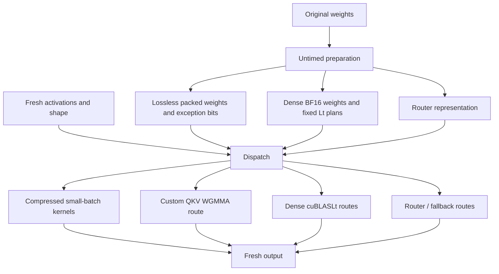

# Workload and implementation architecture

## Computation and constraints

For activation matrix `x[M,K]` and weight matrix `W[N,K]`, each timed call returns `x @ W.T` of shape `[M,N]`. QKV, O, pooler and unpooler use BF16; the router uses FP32 with an allowed BF16 hi+lo representation and FP32 accumulation. `prepare(weights)` may repack fixed weights once, within the challenge's 300-second preparation limit. Timed calls receive fresh activations.

The scored token counts are 1, 8, 16, 32, 128 and 256. The challenge also checks nearby and larger shapes, outliers, sparse probe rows and numerical error. See the supplied [task specification](../muse_bf16_proj/TASK.md) for exact bounds; it remains authoritative over this summary.

## Champion structure

The public adaptation uses specialized small-batch lossless paths with original exception bits. Dense pooler and unpooler at 128/256 tokens use cuBLASLt. QKV128 uses a custom WGMMA route; QKV256 uses Lt. This distinction matters when constructing control experiments. Exact dispatch and fallback conditions are in the source, not fully represented by the diagram.

## SK2 experimental extension

The unpromoted hybrid introduces a staged TMA ring with separate producer, tensor-core consumer and sparse-correction warps. The narrow candidate uses only QKV/pooler/unpooler in the 17–32-token bucket. It retains neighboring-shape behavior instead of replacing only isolated benchmark points. Unsupported packing falls back to the parent.

Its public source is attributed to vjeux. Only the required dependency closure is integrated; the unchanged parent still contains its previously audited compiler helpers. See the [audit](../muse_bf16_proj/research/2026-10-31/vjeux/AUDIT.md).

## What failed to improve the full workload

Custom decoding has real costs: repeated reconstruction across token tiles, exception gathers, shared-memory footprint, register pressure and synchronization. These are hypotheses where only source/scaling evidence exists; they are not all established counter diagnoses. Dense cuBLASLt is already highly tuned, so replacing it with a more elaborate pipeline is not automatically beneficial.
